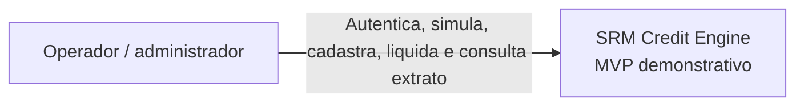
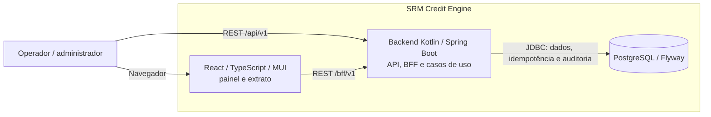

# C4 — contexto e contêineres do MVP

Este diagrama descreve o código integrado e a refatoração B13. O sistema é
demonstrativo: registra liquidações lógicas, sem transferência bancária real.
Organização delimita identidade e isolamento; cedente é a parte que cede o
recebível.

## Nível 1 — contexto

O câmbio é mockado e versionado; não há provedor externo conectado. Não há
Keycloak, pagamento bancário ou implantação em nuvem no MVP.

## Nível 2 — contêineres

O backend é um único processo; API e BFF invocam os mesmos casos de uso sem
HTTP interno. O Compose completo serve o frontend por Nginx e encaminha as
rotas ao backend. Painel e extrato possuem entradas e sessões independentes;
não se presume validação manual ponta a ponta ou uso em dispositivo físico.

## Responsabilidades e fronteiras

- **Domínio:** regras e tipos de negócio, sem Spring, JDBC ou transporte HTTP.
  A precificação usa estratégias, `BigDecimal` e HALF_EVEN.
- **Aplicação:** casos de uso e portas. A simulação pré-cadastro não persiste;
  o resultado de liquidação transporta metadado de replay sem interpretá-lo.
- **Adaptadores:** controllers e DTOs de simulação, cedentes, recebíveis e
  liquidação preservam os dois prefixos. JDBC implementa persistência; Spring
  Security valida a identidade e fornece a organização. O extrato aplica filtros
  e paginação no servidor.
- **Liquidação:** `LiquidacaoJdbc` implementa as portas de idempotência,
  transação, persistência e auditoria. A reserva, a atualização do recebível,
  o snapshot e a auditoria permanecem na mesma transação PostgreSQL; dividir
  esse adaptador sem preservar a coordenação alteraria o risco de atomicidade.
  O replay mantém o status armazenado e reconstrói os campos conhecidos do
  corpo; campos adicionais e representações alternativas não são preservados
  literalmente. Uma nova liquidação retorna 201.
- **Fronteiras automatizadas:** o Gradle verifica dependências do núcleo e, pelo
  parser Kotlin do compilador, declarações de tipos de produção e seus nomes de
  arquivos. Tipos aninhados não são contados como top-level.

## Divergência ADR-010

A [ADR-010 em DECISIONS.md](../../DECISIONS.md) determina `@Version`. O
adaptador JDBC atual usa `UPDATE ... WHERE versao = ? AND status = 'DISPONIVEL'`
e incrementa a versão, sem a anotação `@Version`. A divergência permanece para
decisão do responsável; esta refatoração não altera a decisão nem a semântica
de controle otimista.

## Evidências e limites

As implementações estão em [backend](../../backend/README.md) e
[frontend](../../frontend/README.md); migrations incluem as versões
[V1](../../backend/app/src/main/resources/db/migration/V1__organizacoes_usuarios_cedentes_recebiveis.sql)
a [V4](../../backend/app/src/main/resources/db/migration/V4__perfis_usuarios.sql).
Testes de contrato, idempotência e concorrência estão em
[testes do backend](../../backend/app/src/test/kotlin/br/com/srm/creditengine/).
Sua existência não comprova execução em qualquer ambiente específico.

Não há benchmark ou capacidade de escala medida neste documento. Ver
[ADR-005](../adr/ADR-005-monolito-modular-vs-microservicos.md),
[ADR-018](../adr/ADR-018-postgresql-vs-nosql.md),
[ADR-019](../adr/ADR-019-sincrono-vs-eventos.md) e
[EDA futura](EDA_LIQUIDACAO.md).
