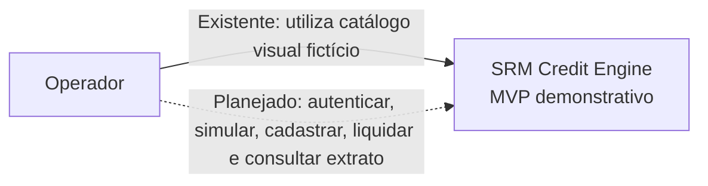
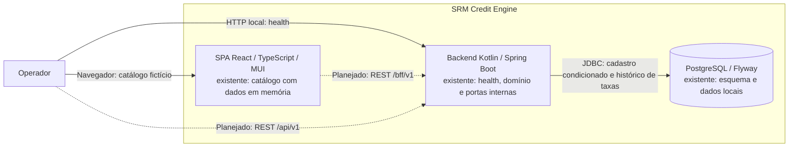

# C4 — contexto e contêineres do MVP

**Referência da revisão:** `develop` em `3cd2bde`, com B01–B05, B12 e F00 integradas. Os diagramas distinguem o que existe nessa revisão do que é requerido pelo MVP. Esquema disponível não é sinônimo de fluxo funcional. O exercício independente de alta escala permanece pendente.

Legenda: **existente** = código ou infraestrutura local versionados; **planejado** = contrato do MVP ainda não integrado. Relações tracejadas são planejadas.

## Nível 1 — contexto do sistema

O sistema destina-se à antecipação **lógica** de recebíveis de cedentes; não há transferência bancária real. Organização é o limite de identidade e autorização; cedente é a parte que cede o recebível. A cotação prevista é mockada e versionada: o estado atual tem registro manual e consulta interna, sem provedor externo ou serviço HTTP de câmbio demonstrado. Não se desenha uma integração externa inexistente.

## Nível 2 — contêineres

As caixas representam contêineres lógicos, não processos por módulo. O backend é um único processo; o Compose local oferece PostgreSQL e perfil opcional para a aplicação. O frontend atual não chama o backend; não se presume HTTPS, implantação em nuvem ou comunicação distribuída. A relação JDBC de cadastro depende de contexto de organização confiável, ainda ausente em produção. O health usa acesso ao banco quando a aplicação está configurada para ele.

## Estado confrontado com o código

| Capacidade | Evidência na revisão | Limite relevante |
|---|---|---|
| Fundação | [backend](../../backend/README.md), [Compose](../../backend/compose.yaml) e [configuração](../../backend/app/src/main/resources/application.yml) | Bootstrap e health não constituem API de negócio. |
| Banco | [V1](../../backend/app/src/main/resources/db/migration/V1__organizacoes_usuarios_cedentes_recebiveis.sql), [V2](../../backend/app/src/main/resources/db/migration/V2__historico_taxas_e_cotacoes.sql), [V3](../../backend/app/src/main/resources/db/migration/V3__liquidacoes_idempotencia_auditoria.sql) | Há tabelas, FKs, unicidade, versão e proteção de históricos; sua existência não executa liquidação, replay nem auditoria. |
| Precificação B03 | [domínio e estratégias](../../backend/dominio/src/main/kotlin/br/com/srm/creditengine/precificacao/dominio/Precificacao.kt) e [testes](../../backend/app/src/test/kotlin/br/com/srm/creditengine/precificacao/PrecificacaoTest.kt) | `BigDecimal`, HALF_EVEN e casos C1–C3 no código/testes; não há endpoint de simulação. |
| Cadastro B04 | [serviço](../../backend/aplicacao/src/main/kotlin/br/com/srm/creditengine/cadastro/aplicacao/ServicoCadastro.kt), [configuração condicional](../../backend/app/src/main/kotlin/br/com/srm/creditengine/cadastro/CadastroAutoConfiguracao.kt) e adaptador JDBC | Não há endpoints; o bean requer `ContextoOrganizacao` confiável, a ser fornecido por S01. Bootstrap de organização é opcional e não autentica. |
| Taxas B05 | [porta](../../backend/aplicacao/src/main/kotlin/br/com/srm/creditengine/taxas/aplicacao/porta/entrada/TaxasPorta.kt), [adaptador JDBC](../../backend/app/src/main/kotlin/br/com/srm/creditengine/taxas/adaptador/saida/HistoricoFinanceiroJdbc.kt) e [guia](../../backend/README.md) | Registro manual interno e seleção por corte UTC, com validade configurável. Não há endpoint, carga automática, integração externa ou snapshot de liquidação persistido pelo fluxo. O motor padrão usa spreads fixos: integrar explicitamente o spread selecionado antes de liquidar. |
| Frontend F00 | [composição](../../frontend/src/main.tsx) e [guia](../../frontend/README.md) | Catálogo fictício em memória; sem sessão, BFF, persistência ou cálculo financeiro. |
| Fluxo financeiro | [SPEC](../../SPEC.md) e [backlog](../../TASKS.md) definem o trabalho futuro | S01, B06–B08, B08-S01, B08-E01, F01 e F03 não estão integradas nesta referência. Sem autenticação funcional, liquidação, simulação pré-cadastro, extrato ou contratos API/BFF de negócio. |

O [backlog](../../TASKS.md) ainda marca B01, B03–B05 e B12 como a fazer, embora constem do histórico integrado. O [README raiz](../../README.md) descreve capacidades pretendidas em termos que podem sugerir funcionamento integral e ainda chama este C4 de rascunho. Recomenda-se consolidação serial desses documentos pelo responsável, sem alterar decisões normativas nesta revisão.

## Responsabilidades e fronteiras

- **Backend hexagonal:** `dominio` contém regras sem Spring/JPA; `aplicacao` define casos de uso e portas; `app` compõe Spring e adaptadores JDBC/HTTP. As dependências apontam para o núcleo. Estratégias de preço não dependem de persistência. A API e o BFF planejados chamarão os mesmos casos de uso no processo, sem HTTP interno.
- **Frontend hexagonal:** apresentação MUI consome aplicação/portas; o adaptador atual é em memória e é composto em `main.tsx`. Portas e adaptador HTTP do BFF são futuros. O navegador não calcula dinheiro nem decide autorização.
- **Transação futura de liquidação:** após obter dados elegíveis sem HTTP externo dentro da transação, o caso de uso deve confirmar atomicamente versão/estado do recebível, liquidação e snapshot, idempotência e auditoria no PostgreSQL; falha implica rollback. `@Version`, tratamento de conflito 409 e replay ainda precisam de implementação e teste em PostgreSQL real.
- **Isolamento:** o comando não escolhe organização no body. A identidade validada deve fornecer o contexto; consultas escopadas e FKs compostas são defesa adicional, não substituto de autenticação/autorização.

## Implicações para evolução de alta escala

Reutilizam-se separação de domínio, precisão decimal, identidade idempotente e fronteira transacional explícita. Possíveis gargalos incluem escrita e índices no banco, contenção em recebíveis ou chaves, pool JDBC, consultas de extrato e capacidade compartilhada do monólito. Reavaliar apenas com medições: limites de consistência e unicidade, capacidade/isolamento de dados, leitura, disponibilidade e recuperação; particionamento ou extração de serviços acrescentam custos e não são uma solução aprovada. Não há benchmark nem proposta para **1 milhão/min** nesta revisão.

Ver [ADR-005](../adr/ADR-005-monolito-modular-vs-microservicos.md), [ADR-018](../adr/ADR-018-postgresql-vs-nosql.md), [ADR-019](../adr/ADR-019-sincrono-vs-eventos.md) e [EDA futura](EDA_LIQUIDACAO.md).
