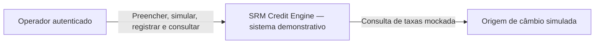
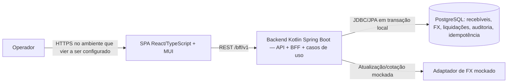

# C4 — Contexto e contêineres do MVP (rascunho inicial)

**Status:** conceitual; revisar após integração B02/F00/B04/B06/B08. **Não é** o exercício independente de alta escala e não comprova componentes implementados.

## Nível 1 — contexto

**Fronteira:** operador utiliza a aplicação para antecipação lógica de recebíveis; não há transferência bancária real. A taxa de câmbio é mockada e versionada.

## Nível 2 — contêineres

**Por que monólito:** BFF e API não se comunicam por HTTP entre si; usam os mesmos casos de uso dentro do mesmo processo. O PostgreSQL mantém uma única fronteira transacional para liquidação. A divisão interna em módulos/portas/adaptadores não representa microserviços.

## O que validar após implementar

- Endpoints reais, canais de autenticação e limites entre SPA e backend.
- Se o FX mockado é in-process ou um serviço HTTP simulado (ajustar diagrama).
- Módulos efetivos, esquema de banco e mecanismo de auditoria.
- Portas, volume/healthcheck, observabilidade e ambiente de execução.

Não utilizar este desenho como prova de 1 milhão de transações por minuto.
