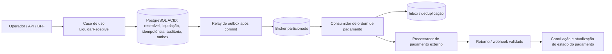

# EDA — Proposta evolutiva do fluxo de liquidação

**Natureza:** desenho de arquitetura futura. **Não implementado, medido ou validado em produção.**  
**Base:** DECISIONS ADR-010/019, SPEC (liquidação = antecipação ao cedente). O MVP confirma a operação local e não executa transferência bancária real.

## 1. Fronteira de consistência

No banco transacional, a mesma transação deve confirmar: (1) recebível atualizado por versão; (2) liquidação única e snapshot imutável de valor/taxa/câmbio; (3) reserva idempotente concluída com resposta original; (4) auditoria; (5) linha na outbox para um evento de domínio. Se falhar, **tudo sofre rollback**. Nenhum HTTP de câmbio ou pagamento dentro dessa transação.

## 2. Eventos e contratos (exemplos ilustrativos)

- `LiquidacaoConfirmada.v1`: `eventId`, `organizacaoId`, `liquidacaoId`, `recebivelId`, `valor`, `moeda`, `ocorridoEm`, `schemaVersion`, `correlationId` (sem dados fiscais/credenciais).
- `OrdemPagamentoSolicitada.v1`: `ordemId` estável, `liquidacaoId`, `montante`, `moeda`, destino via referência segura.
- `PagamentoConfirmado.v1` / `PagamentoRejeitado.v1`: resultado externo com identificador estável e referências de conciliação.

O evento **não redefine** valor já confirmado. Se houver correção contábil, usar evento de compensação/estorno com trilha própria, não mutação silenciosa do snapshot.

## 3. Modelo de estados

- **Liquidação lógica:** `CONFIRMADA` ou `REJEITADA` após transação; confirmada apenas uma vez.
- **Ordem de pagamento (fluxo futuro):** `PENDENTE_ENVIO` → `ENVIADA` → `CONFIRMADA` ou `REJEITADA`; resultado incerto em `DESCONHECIDO`, sujeito a reconciliação. Não reemitir pagamento apenas por timeout sem verificar status no provedor.

## 4. Falhas, duplicatas e idempotência

| Falha | Comportamento requerido |
|---|---|
| Commit local falha | Não há liquidação nem outbox publicada |
| Relay cai após publicar, antes de marcar enviado | Pode publicar de novo: consumidores deduplicam `eventId` |
| Consumidor reprocessa evento | Inbox/UNIQUE impedem executar novamente efeitos locais |
| Processador de pagamento retorna timeout | Verificar por `ordemId`/idempotency key; resultado DESCONHECIDO e reconciliação, não novo pagamento cego |
| Eventos chegam fora de ordem | Versionar evento/entidade e rejeitar transição inválida |
| Poison message | Retry com limites, DLQ e procedimento de reprocessamento auditado |
| Broker indisponível | A transação local permanece válida; outbox fica pendente e alertada |

**Chaves:** identidade da API `(organizacaoId, tipoOperacao, chave)`; chave estável para o pagamento externo vinculada a `ordemId`. **São escopos distintos.** A deduplicação é necessária em cada fronteira, inclusive após redistribuição por shard.

## 5. Operação

- Métricas: backlog/idade da outbox, tempo entre confirmação e envio, retries, DLQ, divergências liquidação ↔ ordem ↔ comprovante, taxa de conflitos e latência de confirmação.
- Segurança: verificação de mensagens e webhooks, autorização por organização, redaction dos logs, segregação de credenciais e retenção auditável.
- Recuperação: replay por chave estável e conciliação contra ledger, nunca por repetição irrestrita de comando financeiro.

## 6. Critérios de validação futura

Teste de falha entre commit e publicação, entrega duplicada, concorrência, retorno de provedor após timeout, evento fora de ordem, isolamento por organização e reprocessamento de DLQ. **Nenhum desses testes é declarado executado neste documento.**
