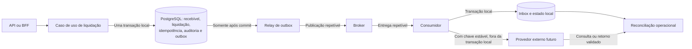

# EDA — evolução proposta para liquidação

**Status:** proposta futura, não implementada nem validada operacionalmente. No `develop` `3cd2bde` há esquema para liquidações, idempotência e auditoria, mas não há liquidação funcional, outbox, broker, relay, inbox, consumidor ou integração de pagamento. O MVP previsto registra antecipação **lógica** e não movimenta dinheiro. A adoção de desembolso, compensação ou estorno depende de decisão humana; este documento não altera a [SPEC](../../SPEC.md) nem [DECISIONS](../../DECISIONS.md).

## Fronteiras e fluxo futuro

Primeiro implementar e provar a liquidação síncrona exigida pelo MVP. Em uma evolução aprovada com eventos, a mesma transação PostgreSQL deverá confirmar a mudança versionada do recebível, a liquidação única e seu snapshot, a conclusão da idempotência com resposta e a auditoria, **mais** a inserção da outbox. Falha antes do commit implica rollback de todos esses efeitos; nenhuma publicação deve ocorrer antes do commit. A confirmação local não significa pagamento. Não executar HTTP de câmbio ou pagamento dentro da transação financeira.

O desenho não exige broker específico nem garante ordenação global. Relay deve selecionar registros pendentes de forma concorrente segura, publicar e marcar entrega **somente após confirmação do broker**; uma queda entre publicação e marcação produz duplicata. Definir posse temporária/recuperação de registros presos e não apagar pendências antes de confirmação e política de retenção. Falha do broker não reverte commit local; aumenta backlog e exige alerta.

## Contratos e idempotência

Exemplo ilustrativo `LiquidacaoConfirmada.v1`: `eventId` estável, `organizacaoId`, `liquidacaoId`, `recebivelId`, valores e moeda em representação decimal exata, instante UTC, versão de esquema e correlação. Contratos devem versionar semântica, preservar compatibilidade e minimizar dados sensíveis; não incluir credenciais ou dados fiscais desnecessários. O evento não reprecifica nem altera o snapshot.

- A chave da API é `(organizacaoId, tipoOperacao, chave)` mais hash do comando: replay idêntico retorna resposta original; divergência gera 409. Ela é distinta de `eventId` e da chave da ordem externa.
- Cada consumidor mantém identidade de consumidor e `eventId` em inbox com unicidade; registro da inbox e efeitos **locais** devem confirmar na mesma transação. Confirmar a mensagem ao broker somente após commit local. Um consumidor diferente pode processar o mesmo evento; retenção da deduplicação deve cobrir a janela de replay.
- Inbox isolada **não** torna uma chamada externa atômica: antes de enviar, persistir intenção/ordem e chave externa estável. O provedor precisa oferecer idempotência e consulta de status com semântica e prazo de retenção conhecidos. Se não oferecer garantias suficientes, não há promessa de pagamento exatamente uma vez; resultado incerto exige bloqueio de reenvio automático e reconciliação/manual.
- Para eventos fora de ordem, definir sequência por entidade e regras de transição; estacionar ou reconciliar lacunas, sem descartar silenciosamente uma mudança necessária. A partição e a garantia de ordem dependem do broker escolhido.

## Estados e recuperação

A liquidação lógica confirmada é distinta de uma ordem de pagamento futura. Um modelo ilustrativo de ordem é `PENDENTE_ENVIO` → `ENVIADA` → `CONFIRMADA` ou `REJEITADA`, com `DESCONHECIDA` quando o resultado for incerto. Transições concretas, inclusive correções após retorno tardio, exigem contrato e revisão de negócio. Timeout não prova falha: consultar o provedor pela chave estável antes de decidir qualquer reenvio; validar autenticidade e duplicidade de retornos.

| Falha | Tratamento proposto |
|---|---|
| Transação financeira falha | Rollback integral, sem evento publicável; retornar erro explícito. |
| Relay cai após publicar | Republicar com mesmo `eventId`; consumidor deduplica efeitos locais. |
| Consumidor cai antes/depois do commit | Antes: reprocessar; depois e antes do ack: redelivery encontra inbox. Não concluir inbox sem o efeito local correspondente. |
| Provedor aceita e resposta se perde | Marcar resultado incerto, consultar e reconciliar; não criar nova chave nem reenviar cegamente. |
| Evento inválido ou poison message | Retry limitado com backoff; quarentena/DLQ, alerta e reprocessamento auditado após correção. |
| Retorno duplicado ou fora de ordem | Deduplicar, validar transição/versão e reconciliar diferenças sem alterar silenciosamente o snapshot. |

Reconciliação compara liquidações, outbox/publicações, ordens, respostas e registros do provedor, por identificadores estáveis e organização. Detectar ausências, duplicatas, divergências de valor/moeda e estados incertos; registrar evidências, responsáveis e resolução auditada. Compensações financeiras, se aprovadas futuramente, devem ter trilha própria; não reescrever liquidação confirmada.

## Operação, riscos e aceite futuro

Monitorar idade e volume da outbox, falhas de publicação, retries, DLQ, atraso por consumidor, ordens desconhecidas e divergências de reconciliação; definir limiares e responsáveis antes de operar. Autorização por organização, autenticação de mensagens/webhooks, segredos fora do código, dados mínimos e retenção auditável são requisitos de desenho, não controles já implantados.

Validar em ambiente representativo: rollback e commit com outbox; falha entre publicação e marcação; duplicatas e concorrência dos consumidores; queda entre efeito local e ack; provedor que aceita mas expira resposta; eventos fora de ordem; DLQ/replay, isolamento e reconciliação. Testar também indisponibilidade prolongada e recuperação do backlog. **Esses testes não foram executados nesta revisão.**

## Implicações de escala

Outbox transacional, identificação estável e reconciliação são princípios reutilizáveis, mas podem gerar contenção, atraso, custo de retenção e pontos quentes. Particionamento, escopo de unicidade, ordenação, garantias do provedor e recuperação exigem reavaliação com medições. Este documento não é a proposta independente de 1 milhão de transações por minuto, que permanece pendente.
