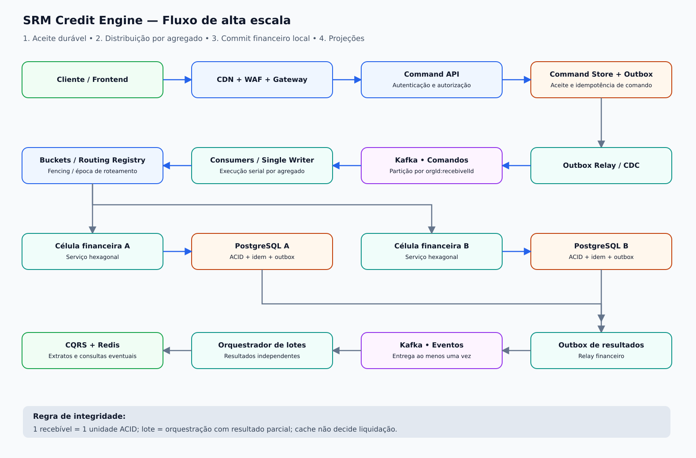
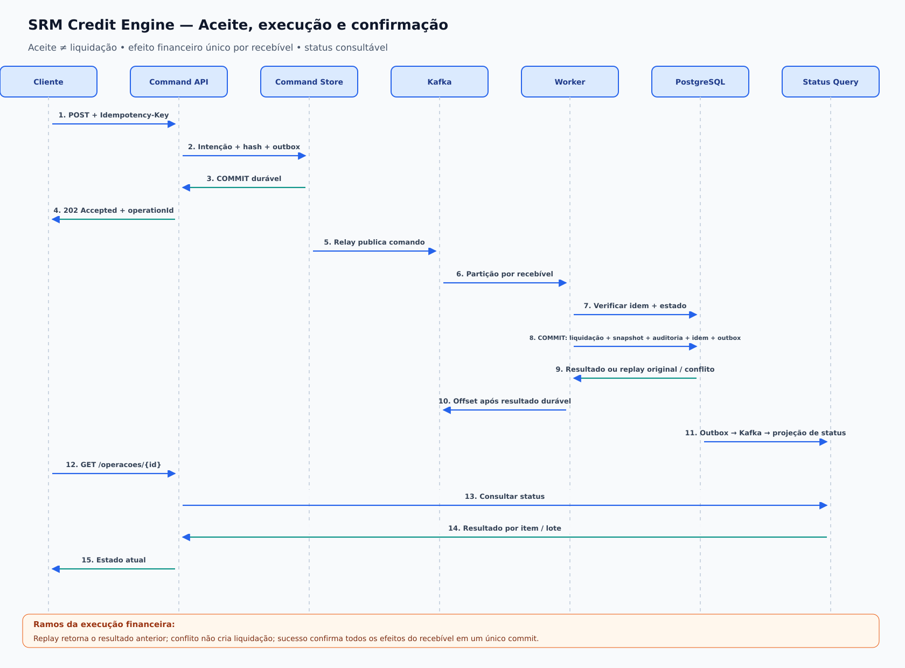

# SRM Credit Engine — Proposta de arquitetura para 1 milhão de transações por minuto

**Tipo:** High-Level Design (HLD) — arquitetura de plataforma financeira de alta escala  
**Versão:** 1.3 — 23/11/2026  
**Status:** Proposta técnica para avaliação; capacidade e operação ainda não validadas por testes  
**Escopo:** processamento distribuído de recebíveis, liquidações, consultas e integrações financeiras

## 1. Resumo executivo

O objetivo é sustentar **1.000.000 de transações financeiras concluídas por minuto** (~16.667/s), com pico exploratório de **3.000.000/min** (~50.000/s), mantendo precisão, isolamento por organização, prevenção de duplicidades, auditoria e recuperação. Capacidade e latências são **metas a medir**, não resultados de benchmark.

**Decisão arquitetural HLD-01:** **o recebível é a menor unidade de consistência e atomicidade**. Uma liquidação de recebível (estado, lançamento, snapshot, idempotência financeira, auditoria e outbox) é uma **única transação ACID local**; outros recebíveis do mesmo arquivo/lote **não** são revertidos em caso de falha de um item. O lote é uma **orquestração com estados individuais e resultado parcial possível**, não uma transação financeira distribuída.

A topologia proposta combina microsserviços por domínio com arquitetura hexagonal, **processamento serializado por recebível (Single Writer lógico)**, Kafka para comandos e eventos, **sharding por chave estável de recebível/organização**, PostgreSQL financeiro por célula, transactional outbox/inbox, CQRS e cache apenas em consultas que toleram defasagem. "Single Writer" é estratégia de ordenação, **não substitui** restrições duráveis, fencing, idempotência nem commits transacionais.

**Integração externa:** a arquitetura admite provedores bancários como fluxo desacoplado, com estados, idempotência e reconciliação próprios. O sucesso do commit financeiro interno não equivale à confirmação de desembolso externo.

## 2. Escopo e premissas arquiteturais

O requisito de capacidade é **1 milhão de transações financeiras concluídas por minuto**. Este HLD propõe uma plataforma para processar recebíveis com baixa contenção, sem exigir transações distribuídas para confirmar um lote completo. O desenho deve justificar **caching, sharding, consistência eventual e idempotência distribuída**, além de disponibilidade, segurança, observabilidade, recuperação e custo operacional.

**Premissas e limites de consistência:**
- O recebível constitui o agregado transacional: seus efeitos financeiros, auditoria, idempotência e publicação confiável de eventos são confirmados em uma única transação ACID local.
- O lote é um agrupamento lógico: seus itens avançam independentemente, e o resultado agregado admite conclusão parcial e atualização eventualmente consistente.
- O processamento de comandos é assíncrono e duravelmente aceito antes da resposta HTTP. A latência de aceite difere da latência até a conclusão financeira.
- Consultas analíticas e extratos podem utilizar projeções eventualmente consistentes; decisões de liquidação e resposta autoritativa por item não dependem de cache.
- Integrações bancárias externas podem ser incorporadas de forma desacoplada, com confirmação, falha, incerteza e conciliação separadas da liquidação interna. Uma transferência externa não integra a transação ACID do recebível.

**Critério de evidência:** a configuração de infraestrutura, o número de células e as estimativas de TPS são propostas de engenharia. A capacidade de 1 milhão/minuto somente poderá ser declarada comprovada após benchmarks, verificação das invariantes financeiras e exercícios de recuperação em ambiente representativo.

**Rastreabilidade do requisito:** `docs/requisitos/ENUNCIADO_ORIGINAL_SRM_CREDIT_ENGINE_V2.md`, seção Staff / Tech Lead (documento de arquitetura para 1 milhão de transações por minuto).

## 3. Definições de carga, operação e SLO

A métrica-alvo mede **liquidações unitárias de recebíveis confirmadas no banco**; não mede usuários, requisições HTTP aceitas, tamanho de lotes, eventos Kafka ou consultas. Por exemplo, um lote de 200 itens com 190 confirmados e 10 rejeitados contribui com **190 transações financeiras concluídas**, não 200 e não 1. Publicar um evento de confirmação não adiciona transações financeiras à contagem.

| Parâmetro | Hipótese de engenharia |
|---|---:|
| Liquidações unitárias concluídas sustentadas | 1.000.000/min ≈ 16.667/s |
| Pico exploratório de liquidações | 3.000.000/min ≈ 50.000/s |
| Carga de pior caso | 100% escrita financeira local com auditoria/outbox |
| Recebíveis por lote lógico | Limite configurável por capacidade; itens podem estar em células diferentes |
| Atomicidade | Por **recebível**, não por lote |
| Aceite HTTP de comando assíncrono | `202 Accepted` **somente após persistência durável da intenção** |
| Conclusão financeira | Estado terminal registrado e consultável por item |
| Latência API de aceite | SLO próprio a medir |
| Latência de confirmação financeira ponta a ponta | SLO distinto (p95/p99), incluindo tempo de fila |
| Disponibilidade | Meta aspiracional 99,99%, com definição de denominador e dependências |
| Pico / backpressure | Proteção explícita de fila, bancos e consumidores |

**Volume bruto ilustrativo:** 1.000.000 × 60 × 24 = 1,44 bilhão de operações/dia. Com apenas 1 KiB de registro médio por operação isso significaria ~1,34 TiB/dia de dados brutos, antes de índices, WAL, snapshots, auditoria, outbox, réplicas e backups. O valor é uma hipótese aritmética, não tamanho comprovado.

### Perfis de teste

| Perfil | Conteúdo | O que comprovar |
|---|---|---|
| A — leitura predominante | 90% leitura; 10% comandos | Cache e projeções |
| B — misto | 50% leitura; 50% comando | Saturação combinada |
| C — escrita financeira | 100% liquidações unitárias | **16.667 commits de negócio/s** com invariantes preservadas |
| D — hotspot | Carga concentrada em uma organização, vários recebíveis | Rebalanceamento de buckets e fairness |
| E — mesmo recebível | Duplicatas, chaves diferentes e reordenação | Uma única liquidação e ordem de comando controlada |
| F — lote parcial | 200 recebíveis, falhas injetadas em alguns | Sucesso dos demais, resumo correto e reconciliação |
| G — recuperação | Kafka/consumer/banco falha e retoma | Sem perda de comandos aceitos ou dupla liquidação |

Contar TPS **na conclusão durável**, com conciliação dos efeitos no PostgreSQL; não confundir `202`, consumo Kafka e confirmação financeira.

## 4. Visão arquitetural — componentes e fluxo de comandos

[Fonte Mermaid editável do diagrama de componentes](diagramas/alta-escala-componentes.mmd). O SVG permite visualização em leitores Markdown sem suporte a Mermaid.

**Microsserviços por fronteira de domínio:** `identity-access`, `receivables-settlement` (mesma fronteira transacional por recebível), `pricing`, `currency`, `statement-query`, `batch-orchestrator` e `notifications`. Cada serviço tem núcleo hexagonal independente; os domínios de preço e câmbio distribuem políticas **versionadas**, sem chamada externa bloqueante dentro do commit financeiro.

**Frontend:** Application Shell React com módulos de domínio. Microfrontends com deploy independente são **opção condicionada à existência de times/cadências independentes**, não requisito de throughput financeiro. Manter contratos, design system e autenticação centralizados.

**Implantação candidata:** EKS Auto Mode para serviços com escalas heterogêneas, HPA/KEDA e ecossistema Kubernetes, **sujeito à comparação real de custo/operação** com ECS/Fargate; nenhum orquestrador resolve contenção de storage. PostgreSQL por célula em HA Multi-AZ; Kafka/MSK; Redis; S3 para arquivos/retensão; observabilidade com OpenTelemetry. Não há escolha cloud implantada neste HLD.

**Semântica de aceite:** `202` significa somente que o comando foi **duravelmente aceito para processamento**, não que houve liquidação. A conclusão exige confirmação no writer financeiro; falhas e rejeições podem ser parciais em um mesmo lote.

## 5. Domínio, fronteiras e propriedade dos dados

- **Identidade / autorização:** `organizacaoId` vem do contexto confiável; autorização de cada operação é verificada no processamento, inclusive após tempo em fila. Credenciais e permissões devem ter política para revogação entre aceite e execução.
- **Recebível como agregado financeiro:** possui proprietário único em um bucket/célula em determinado instante. A transação local grava seu estado, liquidação única, snapshot, idempotência, auditoria e outbox.
- **Liquidação:** `receivables-settlement` concentra efeitos que precisam de commit atômico; separar APIs ou times não implica partir sua transação entre bancos.
- **Pricing/Currency:** estratégias e políticas de taxas/câmbio versionadas; confirmar com regras elegíveis no instante de execução. Se a prévia se tornar obsoleta durante a fila, rejeitar **apenas o item afetado** com necessidade de nova prévia/confirmação, sem reprecificação silenciosa. Replays de transações já concluídas preservam o snapshot original.
- **Lote:** identifica conjunto de comandos e acompanha `PENDENTE`, `EM_PROCESSAMENTO`, `CONCLUIDO`, `CONCLUIDO_PARCIAL`, `REJEITADO`/`FALHOU` conforme estados concretos. Resultados por recebível têm precedência sobre o agregado de apresentação; o status resumido pode atrasar até a projeção ser atualizada.
- **Extrato:** projeção reconstruível com consistência eventual; consulta imediata do resultado financeiro é feita na célula proprietária ou em consulta autoritativa de status, não em cache desatualizado.
- **Integração bancária externa:** fronteira desacoplada de ordens de pagamento, com chave estável no provedor, estados pendentes/incertos/confirmados e reconciliação. A confirmação da liquidação interna não comprova o desembolso externo; timeout não autoriza nova ordem com chave diferente.

**Semântica de lote:** operações de um mesmo lote podem chegar a resultados diferentes. Não existe rollback coletivo nem Saga que prometa desfazer liquidação confirmada automaticamente. Uma eventual compensação financeira exigiria novo fato/lançamento e aprovação do negócio.

## 6. Sharding por recebível e isolamento celular

### 6.1 Chave e propriedade

Adotar `partitionKey = orgId + ":" + recebivelId`. O roteamento usa **buckets virtuais estáveis**, atribuídos a células por registry versionado (por exemplo, 1.024 buckets como hipótese, não tamanho otimizado). O identificador de recebível precisa ser estável desde o cadastro; o comando sempre deve alcançar o mesmo proprietário lógico. O mapeamento bucket→célula é diferente do particionamento Kafka: ambos devem preservar a ordem por agregado, mas não precisam compartilhar o mesmo número de partições.

O sharding por recebível **permite dividir recebíveis de uma única organização entre várias células**, ao contrário do desenho de organização inteira por célula. Cada consulta/índice deve, porém, assegurar isolamento de `orgId`, e uma consulta transversal da organização exige fan-out controlado ou projeção CQRS.

### 6.2 Hotspots, migração e fencing

Uma única entidade extremamente disputada continuará serializada; isso é característica da consistência por agregado. Para movimentar buckets com segurança, bloquear escrita no proprietário antigo, drenar/reconciliar comandos pendentes, replicar estado **incluindo idempotência, snapshots e histórico**, promover um único writer e incrementar a época de roteamento. `Single Writer` baseado apenas no consumer group não impede breves sobreposições após falhas/rebalanceamento; usar **fencing token/lease** verificável e constraints financeiras no banco. Comando para época obsoleta não pode produzir escrita no writer anterior.

### 6.3 Estimativa ilustrativa por célula

| Células | TPS médio/célula no alvo | TPS médio/célula no pico 3× |
|---:|---:|---:|
| 16 | ~1.042 | ~3.125 |
| 32 | ~521 | ~1.563 |
| 64 | ~260 | ~781 |

Essa divisão não é um benchmark. A capacidade real depende de custo do commit, WAL, índices, alocação de buckets, uso de pools de conexões e retenção; o benchmark deve medir **taxa de conclusão**, não apenas aceitação de comandos.

## 7. Atomicidade por recebível e idempotência distribuída

### 7.1 Aceite, execução e confirmação

[Fonte Mermaid editável do diagrama de sequência](diagramas/alta-escala-sequencia.mmd). Os ramos de replay, sucesso e rejeição estão detalhados na fonte e na seção 7.2.

O diagrama apresenta os caminhos principais e uma representação resumida do processamento. Os resultados terminais precisam ser duráveis antes de confirmar o offset, inclusive quando houver rejeição sem nova liquidação. A consulta de status passa por endpoint autenticado; para lote, o resumo pode vir de projeção eventualmente consistente, mas a condição financeira de cada item pode ser conferida na fonte autoritativa. A disponibilidade do Command Store e do writer financeiro são garantias diferentes. A aceitação não deve ser confirmada antes da gravação durável da intenção.

### 7.2 Regras transacionais, sem optimistic locking obrigatório

- **ACID por recebível:** mudança de estado, liquidação, snapshot, auditoria, idempotência e outbox em um único commit do **mesmo banco local**.
- **Single Writer lógico:** serialização dos comandos do mesmo `orgId:recebivelId` na partição Kafka; manter a mesma chave em replays e comandos relacionados. Não há ordenação total entre recebíveis.
- **Proteção durável:** `UNIQUE(organizacao_id, recebivel_id)` para liquidação única (ou constraint equivalente), verificação de status/estado e, se necessário, `UPDATE ... WHERE status='DISPONIVEL'`, além de mecanismos de fencing para workers antigos. Não é necessário `WHERE versao=?` como política central. O `UPDATE` condicional por status é uma guarda de integridade, **não** optimistic locking baseado em versão.
- **Idempotência do item:** escopo `(orgId, recebivelId, tipoOperacao, commandKey)` com hash canônico do payload. Mesma chave/corpo retorna resultado anterior; mesma chave/corpo diferente gera conflito. A chave de submissão do lote possui registro **distinto** no Command Store, vinculado a IDs estáveis de itens. Os contratos da API devem definir separadamente replay de lote e replay de cada operação financeira.
- **Chaves diferentes para o mesmo recebível:** o primeiro comando válido confirmado liquida; os demais retornam `JA_LIQUIDADO`/conflito e **nunca** criam segunda liquidação, mesmo depois de failover ou rebalanceamento.
- **Timeout / resultado incerto:** consultar o estado da mesma operação/chave; não gerar novas chaves de processamento para tentar novamente.
- **Replay Kafka:** entrega ao menos uma vez; offset confirmado somente depois do commit local. Queda após commit e antes do offset causa reentrega, absorvida por constraints/idempotência.
- **Migração de bucket:** mover histórico, registro de idempotência e progresso com fencing, senão uma reentrega pode ser executada em dois writers.
- **Retenção:** guardar idempotência e unicidade financeira além da janela admissível de replays; Redis não é sistema de registro de prevenção de duplicidade.

### 7.3 Orquestração de lote com resultado parcial

O lote contém **manifesto durável** com `batchId`, identidade, hash de conteúdo, itens estáveis e estado por item. Despachar itens via outbox de aceite; consumidores executam em paralelo quando pertencem a recebíveis distintos, inclusive em células diferentes. Atualizar a projeção de status por eventos idempotentes, reconciliando periodicamente com estados autoritativos.

Exemplo: lote de 200 recebíveis, 197 liquidações confirmadas, 2 rejeições por cotação obsoleta e 1 já liquidado. O resultado agregado é `CONCLUIDO_PARCIAL`, com **197 novas liquidações**, sem rollback das confirmadas. Itens rejeitados exigem novo comando/consentimento quando aplicável. Uma retry do **mesmo** item não cria liquidação adicional.

A API deve distinguir `202 Accepted` (enfileirado duravelmente) de `CONCLUIDO`, `CONCLUIDO_PARCIAL`, `REJEITADO` e `EM_PROCESSAMENTO`. Definir tratamento para repetição do mesmo lote, inclusão duplicada de um recebível no arquivo e reenvio de itens por lotes diferentes, preservando chave externa única e unicidade de liquidação.

### 7.4 Retry, DLQ e recuperação

- **Falha transitória (rede, consumer, Kafka):** retry com backoff exponencial e jitter, limitado por prazo/tentativas. A durabilidade está no Command Store/outbox ou no Kafka conforme o estágio; backpressure impede sobrecarga do writer.
- **Falha funcional (estado, autorização, versão de política, cotação):** não fazer retry cego. Registrar rejeição determinística e disponibilizar nova prévia quando o negócio exigir.
- **Falha permanente de processamento:** DLQ/quarentena com identidade do comando, motivo e trilha de reprocessamento; DLQ não substitui banco autoritativo nem reconciliação.
- **Ordenação:** retries em tópico separado podem permitir ultrapassagem por comandos posteriores do mesmo recebível. Usar bloqueio/estacionamento por agregado, controle de sequência ou mecanismo equivalente antes de liberar o próximo comando.
- **Recuperação:** reconciliar comandos aceitos vs. itens no Kafka vs. estados financeiros vs. resumo de lote. Um comando aceito não pode desaparecer por falha de despacho, e um commit confirmado não pode ser repetido financeiramente.
- **Efeitos derivados:** outbox financeiro → Kafka → consumidores com inbox `(consumerId, eventId)` e commit local; extrato e notificações aceitam consistência eventual e replay.

**Limite da garantia:** Kafka pode oferecer semântica exatamente-uma-vez em certos fluxos internos, mas **não** torna atomicamente equivalentes Kafka, PostgreSQL e um provedor de pagamento externo. O objetivo é **efeito financeiro único**, garantido por modelagem + constraints + transação local + reconciliação.

## 8. Caching e consistência

| Dado / fluxo | Política de consistência | Cache |
|---|---|---|
| Autorização de organização | Fonte confiável; revogação previsível | Claims de curta duração e verificação apropriada |
| Cotação PTAX, configuração de spread | Leitura versionada; elegibilidade revalidada no commit | Permitido com `sourceVersion`, expiração e invalidação |
| Pré-simulação | Recalculável, sem persistência financeira | Opcional por inputs + versão de política |
| Consulta de extrato | Consistência eventual aceitável **se explicitada** | Cache/projeção com `updatedAt`, `asOf`, lag e isolamento por organização |
| Estado de liquidação recém-confirmada | Leitura autoritativa/forte na célula | Nunca responder confirmação a partir de projeção atrasada |
| Idempotência e exclusividade do recebível | Forte/ACID local | **Sem cache como autoridade** |
| Dashboard e BI | Eventual | Redis / projeções / materializações |

Em operações críticas, oferecer leitura autoritativa da célula ou mecanismo de read-your-writes por cursor/sequência de projeção. A leitura eventual deve expor atraso conhecido. Não aplicar cache a decisões financeiras de forma a ignorar validade temporal da PTAX, autorização MANUAL ou versão do recebível.

## 9. Segurança e conformidade

Tráfego TLS; WAF, proteção contra DDoS e rate limiting por identidade/organização/endpoint; OIDC com tokens de curta duração, MFA para perfis privilegiados, RBAC e ABAC; mínimo privilégio de IAM; dados e backups cifrados por KMS; segredos em gerenciador próprio; logs com mascaramento e trilha de administração. Toda consulta e comando usa escopo de organização confirmado pelo servidor. Considerar LGPD, retenção, governança de acesso, segregação de funções e registros invioláveis; conformidade regulatória não deve ser declarada sem avaliação e controles específicos.

O sistema deve rejeitar overload com backpressure, limite de filas e resposta clara (429/503 com semântica apropriada), preservando o writer e evitando que um tenant ruidoso esgote recursos comuns. Não fazer retry indiscriminado de comandos financeiros ou externas sem status idempotente.

## 10. Alta disponibilidade, falhas e recuperação

- **Multi-AZ:** cada célula tem writer com failover, réplicas de leitura para consultas e backups testados. Não tratar réplica assíncrona como writer sem procedimento de promoção/fencing.
- **Falha de célula:** isolamento do incidente; outras células mantêm operações. A célula indisponível fica em recuperação, não é movida automaticamente para um banco sem seus dados consistentes.
- **Falha de região:** recuperação em região secundária depende de replicação, fencing do writer anterior e reconciliação de operações em estado incerto. Para operação financeira, **RPO de commits confirmados deve ser aprovado explicitamente**; réplica cross-region assíncrona não garante RPO=0. A estratégia de RTO deve ser testada. O SLO aspiracional de 99,99% não é automaticamente compatível com qualquer RTO regional.
- **Broker indisponível:** commits locais podem prosseguir enquanto outbox e limites de armazenamento permitirem; projeções ficam atrasadas, com sinalização de lag e alarmes. Backlog deve recuperar de forma controlada.
- **Redis indisponível:** degradação graciosa das consultas e cache; não impede correção financeira.
- **Banco sob contenção/WAL saturado:** admission control, ajuste de pool por célula, transações curtas, observação de locks, crescimento planejado. Evitar fan-out simultâneo não limitado aos writers.
- **Câmbio externo indisponível:** uma cotação previamente persistida só pode ser usada dentro de sua política de elegibilidade e validade; não há troca silenciosa de fonte. Operações em BRL que não dependam de conversão não devem ser bloqueadas desnecessariamente.
- **Incidente de idempotência:** isolamento por chave/agregado, congelamento de reenvios incertos, investigação via snapshot e trilha auditável, reconciliação e correção controlada; jamais editar silenciosamente um lançamento confirmado.

## 11. Observabilidade e critérios operacionais

Traços distribuídos com `correlationId`, `operationId`, `cellId`, `routeEpoch`, `organizationId` pseudonimizado, `idempotencyKey` protegida e `eventId`; métricas de throughput e taxa de commit por tipo, latências p50/p95/p99, lock waits, conflitos legítimos, pool, CPU/I/O, commit latency, WAL, replication lag, outbox age, Kafka consumer lag, cache hit, erros por organização, reconciliações divergentes e volume/idade de DLQ. Não logar senhas, tokens, documentos integrais ou payload financeiro sensível.

Os SLOs devem distinguir **sucesso técnico** de **sucesso de negócio**: um `409` válido por concorrência não é indisponibilidade; duplicação confirmada é falha de corretude. Estabelecer orçamento de erro e alertas ligados à experiência/risco e não somente a uso de CPU.

## 12. Plano de validação de capacidade e corretude

Usar k6 distribuído para APIs, geradores de comandos de fluxo assíncrono, integração com PostgreSQL real, teste de caos/rebalanceamento e validação do estado persistido. **1 milhão de transações/minuto significa 1 milhão de liquidações unitárias comprovadamente concluídas**, e não 1 milhão de respostas 202 ou eventos Kafka.

| Experimento | Aceite técnico verificável |
|---|---|
| 1k → 5k → 10k → 16,7k TPS de conclusão | Relatório por etapa, p95/p99 do **tempo até estado terminal**, throughput comprovado no banco |
| Pico 50k TPS | Backpressure e recuperação; sem duplicidades e com SLOs avaliados |
| Soak sustentado | WAL, CPU, memória, conexões, filas, outbox e storage estáveis conforme retenção |
| 100% escrita unitária | Exatamente uma liquidação persistida por recebível elegível; snapshots e auditoria concordantes |
| 200 itens, falha em 3 | 197 commits válidos persistem; 3 itens rejeitados/pendentes conforme causa; lote parcial correto |
| Mesmo recebível, mesma chave | Replay consistente e um único efeito financeiro |
| Mesmo recebível, chaves diferentes | Um sucesso financeiro, outros conflitos/JA_LIQUIDADO sem resíduo duplicado |
| Rebalanceamento Kafka no meio do commit | Fencing/idempotência bloqueiam dois workers de escrever financeiramente |
| Consumer cai após commit, antes do offset | Redelivery não duplica liquidação; estado de item chega ao lote |
| Falha após `202`, antes do despacho Kafka | Outbox reenvia; comando aceito não se perde |
| Alteração de câmbio depois da prévia | Item rejeitado sem reprecificação silenciosa; outras liquidações válidas permanecem |
| Migração de bucket durante retries | Nenhum writer antigo executa comandos após nova época |
| Falha do banco, Kafka ou Redis | Falhas isoladas e recuperação/reconciliação demonstradas |
| Hot tenant com muitos recebíveis | Distribuição de buckets e isolamento da capacidade entre células |

Publicar hardware, serviços/versões, distribuição de dados, parâmetros, tempo de ensaio, p50/p95/p99, erros, custos e verificação SQL. A arquitetura permanece **não validada** até completar esses experimentos.

## 13. Custos, compromissos e alternativas

O custo é dominado por writers financeiros, I/O/WAL, armazenamento, retenção, rede e recuperação, não apenas pelo número de instâncias de aplicação. Fazer orçamento por cenário de transações/segundo, KiB gravados/commit, índices, réplicas, outbox, Kafka, logs, snapshots, S3, backup e tráfego entre AZs/regiões. Simular 16,7k TPS sustentado 24 horas/dia antes de estimar mensalidade; valores de lista não substituem benchmark nem proposta comercial.

| Alternativa | Vantagens | Limite relevante |
|---|---|---|
| Um PostgreSQL writer global | Consistência simples | Limite de commit/I/O, hotspot e blast radius global |
| Redis como autoridade financeira | Latência | Não substitui transação/constraints duráveis |
| NoSQL como sistema de registro | Escala potencialmente conveniente por chave | Invariantes, limites transacionais, consultas e migração exigem prova específica |
| Serviços 100% assíncronos para confirmar liquidação | Absorção de picos | Aceite de comando não significa liquidação concluída; mudança de contrato |
| 2PC entre todos os shards | Atomicidade distribuída em teoria | Contenção, coordenação, falhas de partição e custo operacional |
| Células com PostgreSQL, outbox e recebível como agregado **(proposta)** | ACID por recebível, lote parcialmente executável, escala horizontal | Reconciliação por item, custo de bancos, migração e projeções eventuais |

A seleção entre ECS/Fargate e EKS Auto Mode, e entre Aurora PostgreSQL e RDS PostgreSQL, depende de benchmark, governança, operação e custo. Serviços distribuídos ACID mais recentes podem ser avaliados como alternativa, desde que o contrato do lote e o perfil de custo sejam testados, não presumidos.

## 14. Decisões arquiteturais de referência

| ID | Decisão de referência | Principal consequência |
|---|---|---|
| HLD-01 | **Recebível é unidade mínima ACID** | Lote pode ter resultados parciais; não existe rollback coletivo |
| HLD-02 | Kafka com Single Writer lógico por `orgId:recebivelId` | Ordem por agregado, sem ordenação global; fencing obrigatório |
| HLD-03 | Sharding por buckets virtuais de recebíveis e organização | Uma organização pode usar mais de uma célula; consultas transversais são projeções/fan-out |
| HLD-04 | PostgreSQL por célula com constraints duráveis | Uma única liquidação por recebível mesmo com redelivery e rebalanceamento |
| HLD-05 | `202` somente após persistência durável da intenção | Aceite e conclusão financeira têm estados e SLOs distintos |
| HLD-06 | Idempotência por item + idempotência distinta do manifesto de lote | Replays de lote e de recebível têm identidades e contratos distintos |
| HLD-07 | Outbox + Kafka + Inbox + reconciliação | Entrega ao menos uma vez, efeitos locais deduplicados |
| HLD-08 | CQRS/Redis para leitura eventual, não para decidir liquidação | Extrato pode ficar atrasado; status autoritativo disponível |
| HLD-09 | Microsserviços por domínio, mas `receivables-settlement` unido transacionalmente | Evita Saga financeira somente para preservar um recebível |
| HLD-10 | EKS Auto Mode candidato; ECS/Fargate comparado por benchmark e operação | Não pressupor que Kubernetes aumente TPS do banco |
| HLD-11 | Microfrontends opcionais conforme autonomia de equipes | Independência de deploy ≠ aumento automático de qualidade |
| HLD-12 | 1M/min é meta de **conclusões**, não evidência | Provar throughput e invariantes em ambiente representativo |

**Governança das decisões:** os identificadores HLD-01 a HLD-12 descrevem escolhas desta arquitetura de referência. Qualquer alteração futura deve registrar motivo, alternativas descartadas, impacto em contratos e critérios de validação.

## 15. Plano de implementação e validação

1. Formalizar contrato assíncrono de aceite/status e semântica de conclusão parcial por lote.
2. Prototipar processamento de um recebível com status, unicidade financeira, idempotência e outbox na mesma transação local.
3. Testar duplicatas, falhas antes/depois do commit, rebalanceamento de consumers e fencing de writer.
4. Introduzir manifesto de lote, fan-out durável dos itens e agregação/reconciliação de resultados parciais.
5. Validar 2–4 células e redistribuição segura de buckets com centenas de organizações e distribuição desigual.
6. Dimensionar gradualmente para 16,7k conclusões/s e investigar 50k/s de pico, com custos e observabilidade.
7. Ensaiar recuperação multi-AZ/regional, definir RPO/RTO e apresentar evidências quantitativas, não estimativas como fatos.

## 16. Pontos que exigem definição de contrato de produto

1. Em quanto tempo um item aceito deve atingir estado terminal em carga normal e em picos? O limite é diferente do tempo de aceite HTTP.
2. Qual política de reenvio manual é permitida para itens rejeitados por cotação vencida ou autorização revogada?
3. Qual a estrutura de idempotência para submissão repetida do mesmo lote e para um recebível presente em **dois lotes diferentes**?
4. Quais estados terminais de item constituem `CONCLUIDO_PARCIAL` e como serão expostos no frontend?
5. Qual RPO de operações já confirmadas é aceitável no desastre regional? Replicação assíncrona não promete zero perda.
6. Qual retenção/auditoria legal por item e por lote? Quais custos de armazenamento e recuperação são permitidos?
7. A integração bancária externa fará parte da primeira implantação ou de uma fase posterior? Quais são as garantias de idempotência, consulta de status, reconciliação e prazo de retenção oferecidas pelos provedores?

## 17. Fontes técnicas públicas

- AWS Well-Architected, isolamento de falhas e células: https://docs.aws.amazon.com/wellarchitected/latest/framework/rel10-bp03.html
- AWS, Guidance for Cell-Based Architecture: https://docs.aws.amazon.com/solutions/cell-based-architecture-on-aws/
- Apache Kafka, Design e garantias transacionais: https://kafka.apache.org/design/
- AWS, Aurora PostgreSQL Limitless Database architecture (alternativa para avaliação): https://docs.aws.amazon.com/en_en/AmazonRDS/latest/AuroraUserGuide/limitless-architecture.html
- AWS, Financial Services Industry Lens: https://docs.aws.amazon.com/wellarchitected/latest/financial-services-industry-lens/financial-services-industry-lens.html

---

**Conclusão:** a alternativa B assume o recebível como unidade transacional e o lote como orquestração parcialmente concluível. A escala vem da paralelização entre agregados e células, sem abrir mão de ACID, idempotência e constraints duráveis por recebível, e deve ser provada por testes de conclusão financeira ponta a ponta. **Nenhuma configuração ou quantidade de células apresentada comprova, por si, 1 milhão de transações/minuto.**